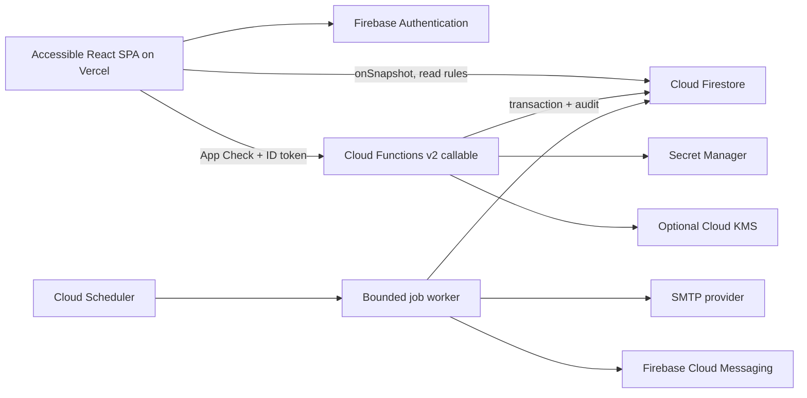

# Architecture

The browser runs a Vite SPA on Vercel. Firebase Authentication establishes identity; Cloud Firestore supplies bounded live read streams. A single Cloud Functions v2 callable (`careCommand`) validates a strict discriminated Zod command, authenticated verified identity, App Check, rate limits, membership, action permission, resource path, and expected version. One scheduled function (`careScheduler`) extends bounded schedules and processes durable notification jobs.

## Boundaries

- `packages/shared/src/domain.ts`: pure recurrence, time conversion, dose state, adherence, retries, and lifecycle rules. Temporal provides timezone and DST semantics.
- `packages/shared/src/schemas.ts`: strict external input schemas and shared types. User-controlled resource IDs exclude path separators.
- `functions/src/repositories/context.ts`: transaction authorization, optimistic version validation, append-only application audit writes, injectable mail and vault interfaces.
- Domain services perform related reads before transaction writes. Permission checks participate in the transaction, so membership updates can force a retry.
- `apps/web/src/lib/firebase.ts`: public configuration, emulator wiring, App Check, callable adapter. Components never import Admin SDK or backend secrets.
- `apps/web/src/hooks/useLive.ts`: bounded subscriptions, snapshot errors, cache indication, and cleanup.

## Deliberate structure decisions

Pages are organized by workflow rather than duplicating 32 role-specific screens. The same dashboard, medication, appointment, history, and activity components expose permitted capabilities to owners, caregivers, and family. The circle switcher serves assigned profiles; security and permission controls are consolidated into Care Circle and Settings.

TanStack Query is omitted: live reads use Firestore listeners; bounded analytics use a callable with effect cancellation. Adding another cache would duplicate state and complicate revocation. Realtime Database presence and Google Calendar OAuth are not required and are omitted. Dialog/Button source follows the Radix and class-variance-authority pattern used by shadcn/ui, with the application’s own styles.

Functions are bundled with esbuild. Shared TypeScript, Zod, and Temporal are bundled into `functions/lib/index.cjs`; runtime Google/Firebase/SMTP packages remain external. The backend has a standalone lockfile and patched overrides so Firebase installation is independent of workspace symlinks.

## Efficiency bounds

20 active members per circle; 5 owned circles per account; at most 8 dose times per medication; 7-day rolling horizon, capped at 14 by the pure engine; 10 schedule extensions and 30 jobs per scheduler invocation. Live query caps range from 1 to 300. History uses 50-record cursor pages. Reports use 36 bounded dose aggregate queries (two windows and seven daily buckets, four counts each), plus two permission-gated event totals and one 100-record acknowledgement sample, returning totals rather than medical documents.

There is no full-circle scan in the worker. Indexed `nextAt` and `nextAttemptAt` queues find due work. Queue throughput is intentionally conservative; monitor backlog and tune before large deployments.

## 3.0 extensions

`shared/care.ts` supplies deterministic stock, comparison and responsibility calculations. `functions/src/care/` contains transactional inventory/tasks/follow-up, prescription reconciliation, and encrypted companion/passport/check-in services. New feature routes are lazy-loaded. `app/navigation.ts` combines role-specific navigation with permission-filtered route mounting; authorization remains in the backend and Firestore. `i18n/` centralizes core product translations and safe English fallback without translating clinician-entered text. `styles/premium.css` implements the new tokens and responsive shell on top of preserved feature styles.

See [the upgrade guide](UPGRADE_3_0.md) for each service boundary and the existing-circle migration. `migrate-v3.ts` defaults to a single-circle dry run; it changes directory projections only.
